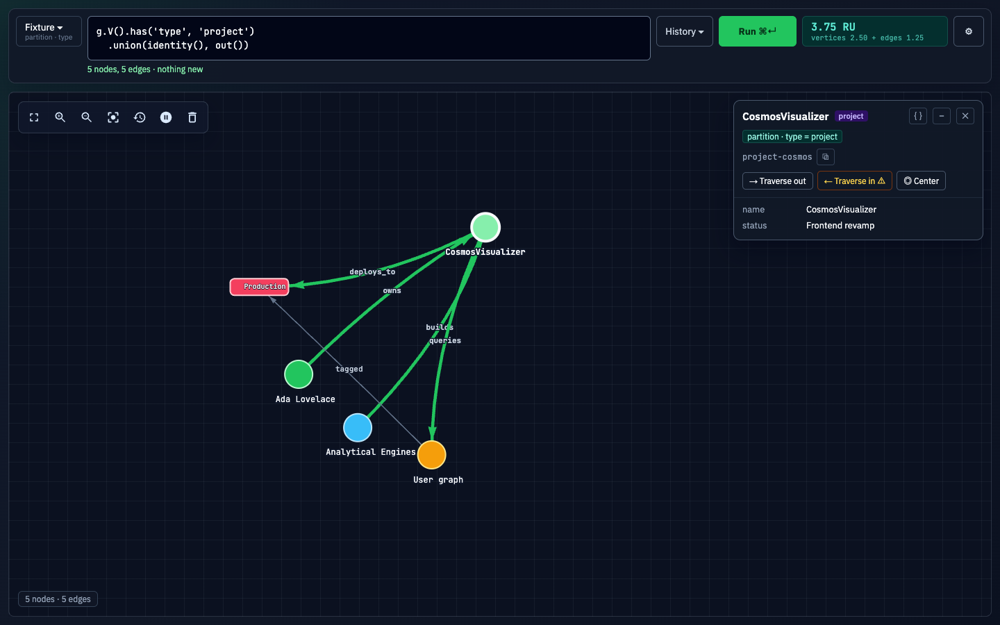
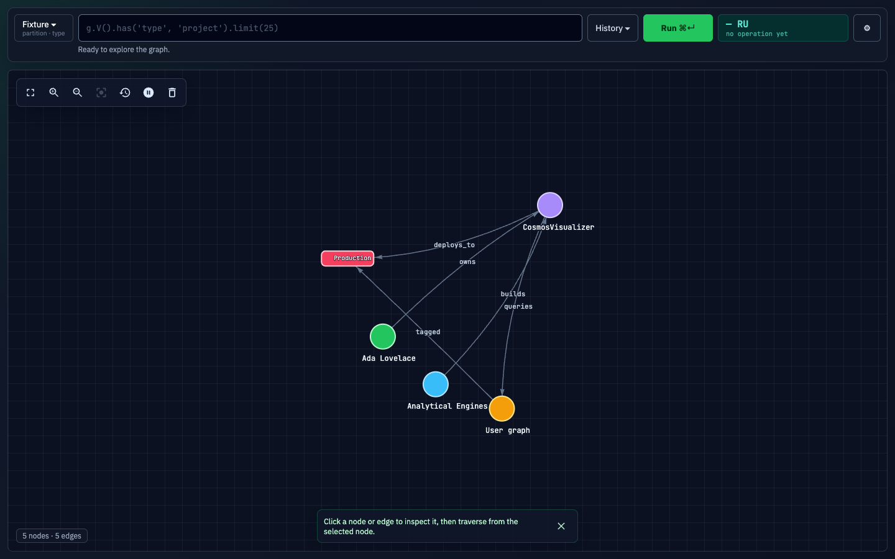
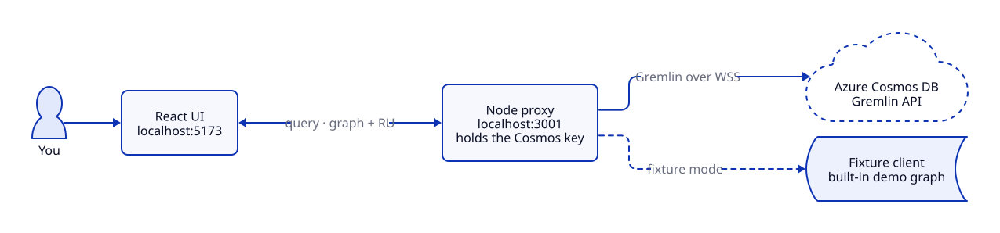

# CosmosVisualizer

[](https://github.com/pinktownscavenger/CosmosVisualizer/actions/workflows/ci.yml)

A local React workspace for exploring Azure Cosmos DB Gremlin API graphs. Run Gremlin vertex queries through a local proxy, see the result rendered with `vis-network`, and keep an eye on request units (RU), partitions, and the active connection while you explore. A built-in demo graph lets you try it without Azure credentials.

This project is a modernized fork of [prabushitha/gremlin-visualizer](https://github.com/prabushitha/gremlin-visualizer), originally created by Umesh Prabushitha Jayasinghe and released under the MIT License.



## Try It In Under A Minute

Fixture mode uses a built-in sample graph and fixture query responses, so no Azure account is needed.

```sh
npm install --legacy-peer-deps
npm run start:fixture
```

Open http://localhost:5173. The demo graph is seeded as soon as the page loads:



Type a query into the top bar and press **Run** (or ⌘↵ / Ctrl+↵):

```groovy
g.V().limit(25)
```

Click a node to open the inspector card, then traverse from it.

Fixture mode sets `USE_FIXTURE_DATA=true` for the proxy process. Do not use it when validating a real Cosmos DB connection.

## Use With Cosmos DB

Requirements:

- Node.js 20.12 or newer and npm
- Azure Cosmos DB account using the Gremlin API

Copy the example environment file and fill in your Cosmos DB details:

```sh
cp .env.example .env
```

Required server variables:

```sh
COSMOS_ENDPOINT=wss://your-account.gremlin.cosmos.azure.com:443/
COSMOS_PRIMARY_KEY=your-cosmos-primary-key
COSMOS_DATABASE=your-database
COSMOS_CONTAINER=your-graph-container
COSMOS_PARTITION_KEY=type
```

Optional variables:

```sh
CORS_ORIGIN=http://localhost:5173
PORT=3001
HOST=127.0.0.1
VITE_API_BASE_URL=
```

Leave `VITE_API_BASE_URL` blank unless the frontend is served from a different origin than the proxy.

Start the app:

```sh
npm start
```

Shell variables take precedence over `.env`. Both servers listen on loopback only; set `HOST` only if you deliberately need to expose the proxy. If a Cosmos variable is missing or invalid, the app starts disconnected and you can connect from the connection chip in the top bar.

`COSMOS_PARTITION_KEY` takes a property name such as `type` or `/type`; it drives partition display and fan-out advisories.

## Features

- Credential-free fixture mode with a seeded demo graph. Real Cosmos connections start empty and spend no RUs until you run a query.
- Switch connections in the app without restarting the proxy.
- A single top bar: connection chip, multi-line query editor (⌘↵ / Ctrl+↵ to run, ↑/↓ to recall history), history menu, RU readouts, and settings.
- Per-operation RU totals with vertex/edge breakdowns, plus a session total that resets on a connection switch or when clicked.
- One message line for status, partition fan-out advisories, and errors, with recovery actions such as **Edit query**, **Retry**, and **Switch connection**.
- Full-width canvas with fit, zoom, center, reset, physics, and clear-graph controls.
- A floating inspector card for the selected node or edge: partition chip, copyable id, traversal actions, property values, and a raw JSON view.
- Colour nodes by **Type** or **Partition** from the canvas legend, using colour-blind-safe hues. Vertices whose partition value was not returned are drawn hollow and dashed.
- **Scope to partition** inserts `.has('<partition key>', '')` into an unscoped scan or id lookup (pre-filled from the selected node) without running it.
- Configurable node labels by vertex type and property field.

## How It Works



The browser never talks to Cosmos DB directly. It sends queries to the local proxy, which runs the vertex query, fetches the adjacent edges, and returns the graph with its RU charges. In fixture mode the proxy answers from a built-in demo graph through the same code paths, so everything except a real connection can be tried without Azure.

Fan-out advisories never rewrite or block a query, and RU or partition data that Cosmos does not return is shown as unavailable rather than guessed.

## Credentials

Connection details entered in the UI are held only in memory by the local proxy. The primary key is sent once to the proxy and is never stored in app state, history, responses, or browser storage; the dialog clears it after submission or dismissal.

Do not commit `.env` files or Cosmos DB keys. If a key was ever committed or shared, rotate it in Azure.

The proxy forwards your Gremlin query text to the configured database as-is, and the connection API is unauthenticated by design for local, single-user use. Run it only in trusted environments.

## Scripts

```sh
npm run client          # Start the Vite frontend
npm run server          # Start the API proxy against Cosmos DB
npm run server:fixture  # Start the API proxy with fixture data
npm run start:fixture   # Start frontend + fixture proxy
npm run build           # Build the frontend
npm test                # Run the Vitest suite
```

## Docker

```sh
docker build --tag=cosmos-visualizer:latest .
```

`.env` is excluded from the image; pass it at run time. Publish the ports on loopback to keep them off your network:

```sh
docker run --rm \
  -p 127.0.0.1:5173:5173 \
  -p 127.0.0.1:3001:3001 \
  --env-file .env \
  --name=cosmos-visualizer \
  cosmos-visualizer:latest
```

For fixture data instead, replace `--env-file .env` with `-e USE_FIXTURE_DATA=true`.

## License

Released under the [MIT License](LICENSE). The original fork attribution is preserved above and in the license file.
